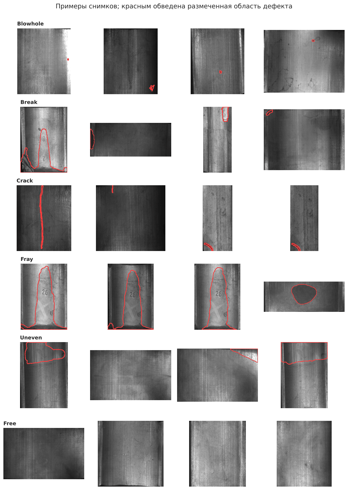
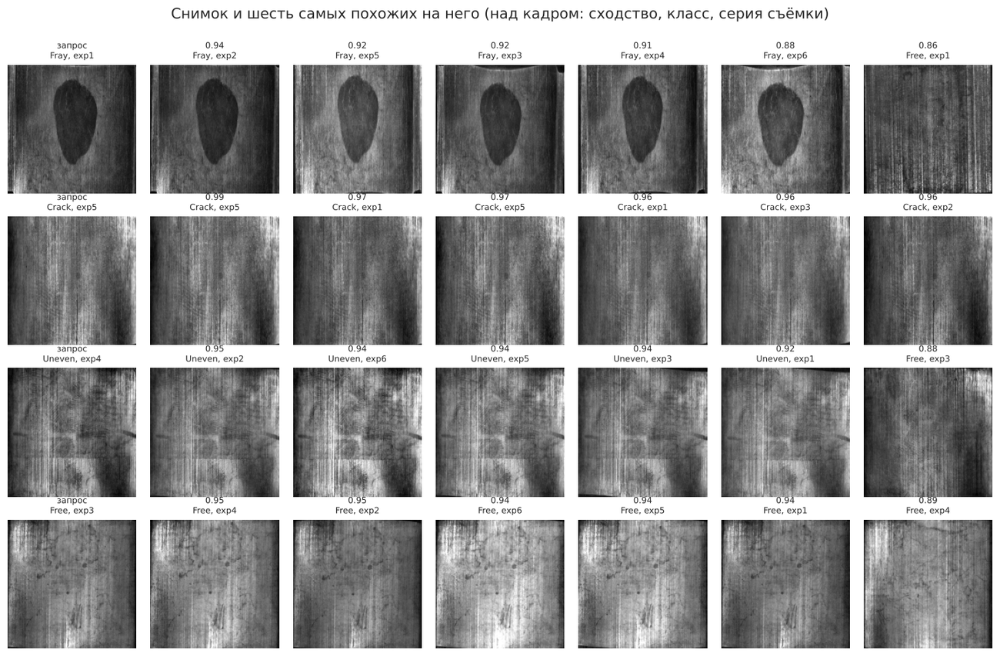
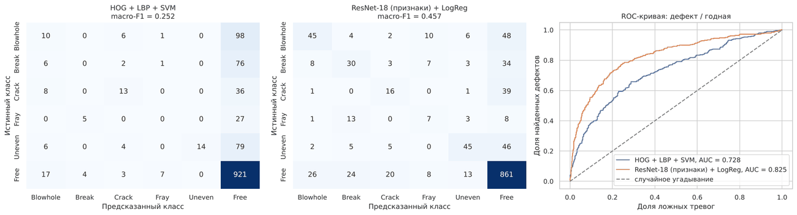
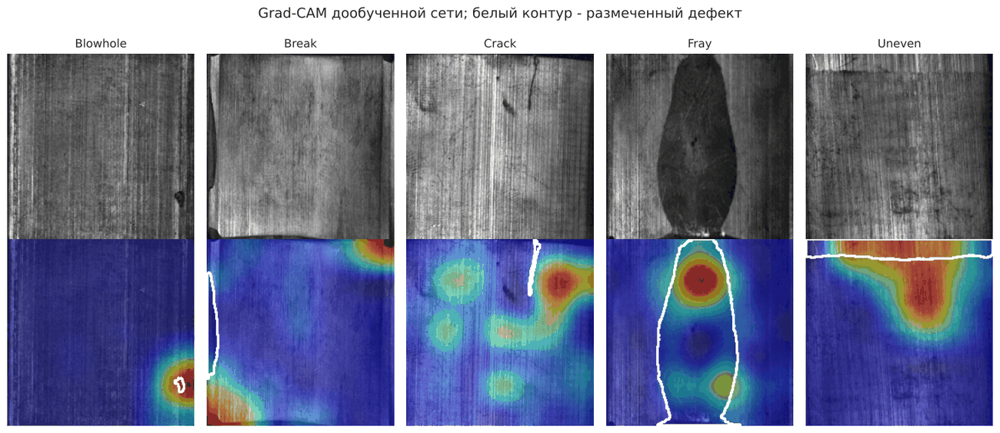

# Контроль качества магнитной плитки: классификация дефектов и проверка на утечку данных

Учебный проект по компьютерному зрению. По снимку поверхности ферритовой магнитной плитки нужно определить, есть ли на ней дефект и какого он типа: раковина, трещина, скол, потёртость или неравномерная шлифовка.

Весь проект находится в одном ноутбуке: [`magnetic_tile_defects.ipynb`](magnetic_tile_defects.ipynb). В нём есть код, теоретические пояснения к каждому методу и выводы по каждому разделу.



## Главный результат

При обычном случайном разбиении простая модель (HOG + LBP + SVM) показывает macro-F1 **0.954**. Проверка показала, что эта цифра ничего не говорит о качестве: каждый участок плитки снят в наборе примерно шесть раз при разной экспозиции, и почти одинаковые кадры попадают одновременно в обучение и в тест.



После разбиения по участкам плитки та же модель с теми же гиперпараметрами даёт macro-F1 **0.252**. Все дальнейшие сравнения проведены уже по честной схеме.

## Результаты в честной схеме

5-кратная кросс-валидация с разбиением по участкам, 1344 снимка, около 230 уникальных участков.

| Модель | Macro-F1 | 95 % ДИ | Balanced accuracy | ROC-AUC (дефект / годная) |
|---|---|---|---|---|
| Константный прогноз | 0.138 | [0.131; 0.147] | 0.167 | 0.500 |
| HOG + LBP + SVM | 0.252 | [0.191; 0.311] | 0.236 | 0.728 |
| ResNet-18 (замороженные признаки) + логистическая регрессия | **0.457** | [0.368; 0.539] | 0.431 | **0.825** |

Доверительные интервалы получены бутстрепом по участкам плитки.



Дополнительно:

- **Сегментация по правилам** (вычитание фона, порог Оцу, морфология) не работает: средний IoU не выше 0.14, а на годных плитках алгоритм срабатывает в 97 % случаев.
- **Дообучение ResNet-18 на PyTorch** оценено на одном фолде: macro-F1 0.453 против 0.365 у замороженных признаков на том же фолде. Разброс по эпохам сопоставим с этой разницей, поэтому вывод о преимуществе дообучения не делается.
- **Grad-CAM**: максимум тепловой карты дообученной сети попадает в размеченный дефект в 62 % случаев при 13 % для случайной точки, хотя маски в обучении не использовались.



Качество лучшей модели для производства недостаточно: при 10 % ложных тревог она находит около 55 % дефектных снимков. Причина в объёме данных: на пять классов дефектов приходится 68 уникальных участков. В выводах ноутбука перечислены ограничения работы и возможные следующие шаги (обучение сегментации по маскам, постановка как поиск аномалий).

## Содержание ноутбука

1. Постановка задачи и данные
2. Разведочный анализ: дисбаланс классов, размеры снимков, площадь дефектов
3. Предобработка в OpenCV: изменение размера, CLAHE
4. Сегментация дефектов без обучения и её оценка по IoU
5. Классический подход (HOG, LBP, SVM) и наивная оценка
6. Проверка на утечку данных и восстановление групп снимков
7. Честная схема оценки: кросс-валидация по группам, кластерный бутстреп
8. Перенос обучения: признаки ResNet-18
9. Дообучение сети на PyTorch с аугментациями
10. Итоговое сравнение
11. Интерпретация с помощью Grad-CAM
12. Выводы, ограничения, направления развития

## Стек

| Задача | Инструменты |
|---|---|
| Работа с изображениями | OpenCV, scikit-image |
| Данные и расчёты | NumPy, pandas, SciPy |
| Классическое ML, валидация, метрики | scikit-learn |
| Нейросети | PyTorch, torchvision |
| Аугментации | Albumentations |
| Графики | Matplotlib, Seaborn |

## Запуск

```bash
git clone https://github.com/FDB1228/Magnetic_tile_defects_CV.git
cd Magnetic_tile_defects_CV
pip install -r requirements.txt
jupyter notebook magnetic_tile_defects.ipynb
```

Датасет (около 110 МБ) и веса ResNet-18 скачиваются автоматически при первом запуске. Полный прогон на процессоре занимает около 13 минут, из них 9 минут уходит на дообучение сети. Графический ускоритель не требуется. Результаты в ноутбуке получены на Python 3.13, OpenCV 5.0, PyTorch 2.15, scikit-learn 1.9.

## Данные

Набор [Magnetic Tile Defect](https://github.com/abin24/Magnetic-tile-defect-datasets.): 1344 полутоновых снимка шести классов с попиксельными масками дефектов. В репозитории проекта данные не хранятся.

> Huang Y., Qiu C., Yuan K. Surface defect saliency of magnetic tile. The Visual Computer, 2020.
